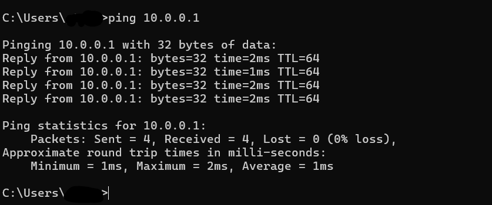
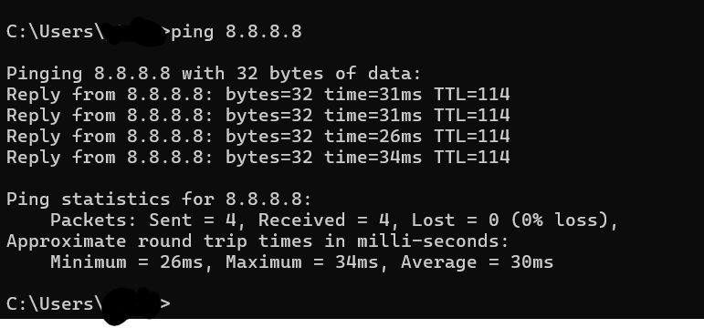
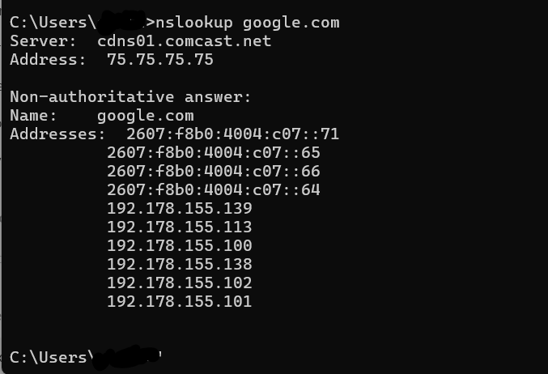
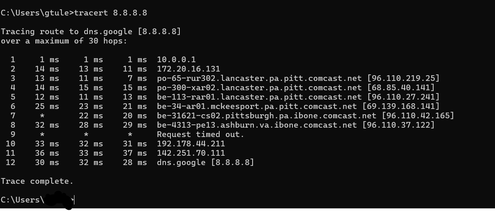
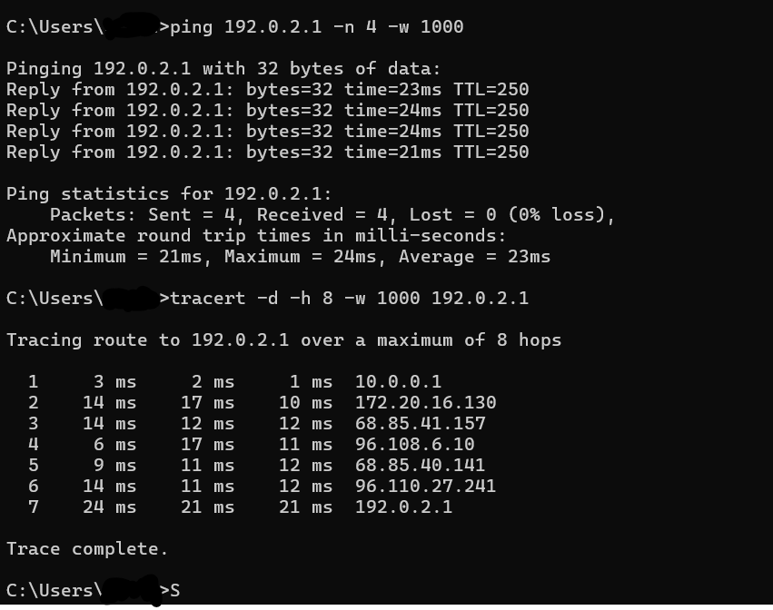

# NOC Network Troubleshooting Lab

## Project Overview
This hands-on lab demonstrates basic network connectivity testing, DNS troubleshooting, route tracing, and network investigation using Windows Command Prompt.

The goal was to practice troubleshooting techniques commonly used by Network Operations Center (NOC) Technicians to identify connectivity problems and document findings.

## Tools Used
- Windows Command Prompt
- IPConfig
- Ping
- NSLookup
- Tracert

## 1. Network Configuration
Used `ipconfig /all` to examine the computer's network configuration, including its IPv4 address, subnet mask, default gateway, DHCP settings, and DNS servers.

## 2. Router Connectivity Test
Command: `ping 10.0.0.1`

- Sent: 4 packets
- Received: 4 packets
- Packet loss: 0%
- Average response time: 1 ms

Result: Successfully communicated with the local router.

## 3. Internet Connectivity Test
Command: `ping 8.8.8.8`

- Sent: 4 packets
- Received: 4 packets
- Packet loss: 0%
- Average response time: 30 ms

Result: Successfully reached an external server, confirming external IP connectivity during the test.

## 4. DNS Resolution Test
Command: `nslookup google.com`

- DNS server: cdns01.comcast.net
- DNS server IP: 75.75.75.75
- Successfully resolved google.com to multiple IPv4 and IPv6 addresses.

Result: DNS name resolution was functioning correctly.

## 5. Network Route Analysis
Command: `tracert 8.8.8.8`

- Traced network traffic toward Google's public DNS server.
- Destination reached in 12 hops.
- Observed an intermediate router that did not respond to traceroute probes.
- Confirmed that the destination was reachable despite the intermediate timeout.

Result: Successfully examined the network path and demonstrated that an intermediate timeout does not necessarily indicate a network failure.

## 6. Reserved IP Address Investigation
Commands:
- `ping 192.0.2.1 -n 4 -w 1000`
- `tracert -d -h 8 -w 1000 192.0.2.1`

Initially expected the reserved documentation address to be unreachable.

Observed:
- Four successful ping responses.
- 0% packet loss.
- Average response time: 23 ms.
- Traceroute reached the address in 7 hops.

Result: Investigated an unexpected successful response from a reserved documentation address. The tests did not establish why the address responded or confirm an actual network outage.

## NOC Investigation Summary
**Scenario:** Validate local network connectivity, external connectivity, DNS resolution, and network routing. Investigate an unexpected response from a reserved test address.

**Troubleshooting performed:**
1. Reviewed network configuration using IPConfig.
2. Tested local router connectivity using Ping.
3. Tested external IP connectivity using Ping.
4. Verified DNS resolution using NSLookup.
5. Examined the route to an external destination using Tracert.
6. Investigated the unexpected response from a reserved documentation address.

**Findings:** Local connectivity, external IP connectivity, and DNS resolution were successful during testing. No actual network outage was confirmed. The reserved address responded unexpectedly and would require additional investigation to determine why.

**Conclusion:** Documented the evidence and distinguished confirmed test results from assumptions about network failures.

## Skills Demonstrated
- Network connectivity troubleshooting
- IP addressing and network configuration
- DNS resolution testing
- Packet loss and latency interpretation
- Network route tracing
- Incident investigation and technical documentation
